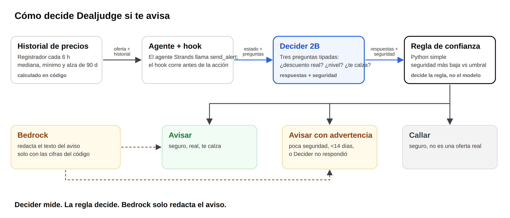
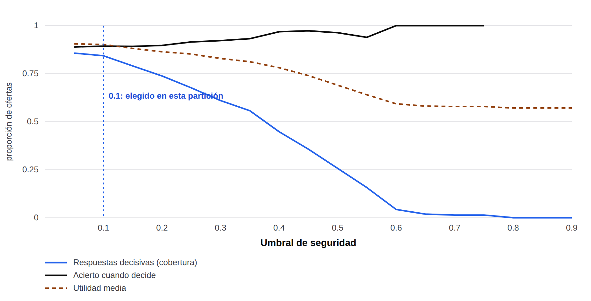

# Dealjudge

**¿Este descuento es real?** Dealjudge vigila productos concretos y juzga cada descuento contra los últimos 90
días de precios. Solo avisa cuando hay algo real que decir, o cuando tiene dudas, y entonces lo dice.

*English version: [README.md](README.md).*


*Todo lo que aparece en la captura es simulado; las tiendas son inventadas.*

Hecho para el **Agent Experience Hackathon: Strands Decider** de AWS. Etiqueta de patrón: `#policy`.

## Qué hace

Durante los Cyber, muchas tiendas suben un precio unas semanas y luego lo "rebajan" hasta donde siempre estuvo.
Para cada oferta, Dealjudge le pide a [Strands Decider 2B](https://huggingface.co/StrandsAgents/strands-decider-2B-hobson-v19)
que lea un resumen corto y estructurado del historial de precios (toda la aritmética la hace el código) y responda
preguntas tipadas:

| Pregunta | Tipo | Quién responde |
|---|---|---|
| ¿El descuento real es de 10 % o más, contra la mediana de los 90 días previos a cualquier alza reciente? | sí/no | Decider |
| ¿Qué nivel de oferta es? `no_deal` / `marginal` / `good` / `very_good` / `exceptional` | opción | Decider |
| ¿Le sirve a este usuario (tope de precio, nivel mínimo)? | sí/no | **código** (ver Límites) |

Una regla en Python puro (`src/dealjudge/policy.py`) convierte las respuestas en una de tres acciones:

- **`alert`**: se avisa de un descuento real que le sirve al usuario, con las cifras que lo respaldan.
- **`stay_silent`**: un "no es real" o "no le sirve" con seguridad se queda en silencio.
- **`alert_with_warning`**: cualquier duda (confianza baja, o menos de 14 días de historial) se avisa **con una advertencia visible**.

Un `InterventionHandler` de Strands aplica esa decisión antes de que se ejecute la herramienta `send_alert`
(`src/dealjudge/handler.py`), y Amazon Bedrock redacta el aviso usando solo las cifras que le entrega el código.
El modelo nunca es la compuerta: Decider mide, `decide` decide.



**Un idioma por ejecución.** Todo lo que lee el modelo y ve el usuario (texto de estado, preguntas, avisos,
motivos) sale de `src/dealjudge/i18n.py`, en inglés (por defecto) o en español (`--lang es`). Los identificadores
internos siempre están en inglés.

## Cómo ejecutarlo

```bash
uv venv && uv pip install -e ".[dev]"            # Python >= 3.10
.venv/bin/pytest -q                              # pruebas unitarias, sin red

# 1. Decider (necesita GPU: unos 300 ms por llamada en una GPU de portátil, unos 12 s en CPU)
strands-decider serve StrandsAgents/strands-decider-2B-hobson-v19 --port 8000
.venv/bin/python scripts/smoke_decider.py --lang es    # imprime las respuestas crudas

# 2. Evaluación: Decider contra la regla antigua y contra un LLM, con ofertas simuladas
export AWS_PROFILE=<perfil con acceso a Bedrock>  # requiere awscrt para perfiles de `aws login`
.venv/bin/python scripts/run_evaluation.py --n 30 --lang es    # escribe results/es/

# 3. El agente de punta a punta, y la página
.venv/bin/python scripts/run_agent_demo.py --lang es
.venv/bin/python scripts/build_demo.py --lang es               # escribe web/data/demo.es.json
python -m http.server -d web 8765                              # y abre http://localhost:8765
```

Modelos de Bedrock usados: `us.anthropic.claude-haiku-4-5-20251001-v1:0` (línea base LLM) y `amazon.nova-lite-v1:0`
(texto del aviso y modelo propio del agente), ambos en `us-east-1`.

## Evaluación

`results/<idioma>/evaluation.md` lo genera `scripts/run_evaluation.py` y contiene las cifras del artículo:
acierto de avisar o callar, acierto de real/falso y de nivel, acierto por escenario, latencia, costo y calibración.
El umbral de confianza (0,1) se fija en una partición de desarrollo (semilla 101) y las cifras se reportan en otra
de prueba (semilla 303, nunca inspeccionada al ajustar). 210 ofertas simuladas de prueba, una corrida por idioma.

| Métrica (partición de prueba) | Decider + regla, EN | Decider + regla, ES | Regla antigua `cyber-watch` | Claude Haiku 4.5, EN / ES |
|---|---|---|---|---|
| Acierto avisar vs callar | **0,943** | 0,919 | 0,814 | 0,938 / 0,938 |
| Acierto de la acción en 3 vías | 0,943 | 0,895 | 0,690 | 0,933 / 0,929 |
| Acierto real vs falso | 1,000 | 0,948 | n/a | 0,962 / 0,971 |
| Acierto del nivel de oferta | 0,790 | 0,743 | n/a | 0,919 / 0,948 |
| Llamadas fallidas | 0 | 0 | 0 | 8 / 6 |

Decider + regla es claramente mejor que la regla antigua (+13 puntos en inglés, +10 en español). Frente al LLM
grande es un **empate técnico en si avisar** (0,943 contra 0,938 en inglés es ruido con n=210) y **pierde en el
nivel de oferta** (0,79 contra 0,92). Lo que aporta es una llamada local sin costo de API, sin llamadas fallidas
(el LLM falló 8 y 6 veces, contadas como advertencias) y una confianza sobre la que el código puede filtrar.
Respondió con decisión en el 86 % (EN) / 83 % (ES) de las ofertas de prueba y acertó el 93 % / 91 % de las veces
en esas, pero en este benchmark la puerta de confianza hizo muy poco (ver abajo).

**Latencia y costo, medidos por separado** (`scripts/bench_latency_cost.py`, inglés, 70 estados simulados de la
semilla de desarrollo, llamadas secuenciales, Decider y el LLM en fases separadas; resultados en `results/bench/en/`):

| | Decider 2B (RTX 4050 de portátil, local) | Claude Haiku 4.5 (Bedrock, desde la misma máquina) |
|---|---|---|
| Latencia mediana | **278 ms** (p95 336 ms) | 940 ms (574 ms según Bedrock) |
| Llamadas fallidas | 0 de 70 | 52 de 70 (límite de tasa, sin reintentos) |
| Costo de API por 1.000 decisiones | 0 | US$ 0,53 (383 tokens de entrada, 29 de salida) |

No es el mismo montaje: una GPU local junto al script contra una API remota a la que se llega por internet desde
Chile, así que la diferencia es en parte del modelo y en parte de la red. El p95 del LLM no es fiable (18 llamadas
exitosas). La cuota de Bedrock de esta cuenta limitó la tasa de casi todas las llamadas secuenciales, y probablemente
por eso el LLM falló 8 y 6 veces en la evaluación. Las líneas de latencia de la propia evaluación (484 ms EN, 744 ms
ES para Decider) intercalan llamadas a Decider y al LLM; en mis pruebas eso inflaba a Decider (545 ms intercalado
contra 278 ms en fases separadas), probablemente porque la GPU del portátil baja su reloj mientras espera las
llamadas lentas al LLM. Cita el benchmark, no esas líneas. Solo se midió en inglés.

**Qué hace la puerta de confianza.** Con el umbral elegido (0,10) casi nunca se activa. En la partición de prueba,
las 30 ofertas en las que Decider no respondió con decisión en inglés son exactamente las 30 con menos de 14 días de
historial, que advierte la regla: la puerta de confianza se activó en 0 de 210 casos. En español se activó en 6 (36
advertencias, 30 de ellas por la regla de historial). Así que el "86 % decisivo, 93 % de acierto" describe ofertas
con historial suficiente, no a un modelo que supiera cuándo abstenerse. El barrido de abajo (partición de desarrollo,
la misma en la que se fija el umbral; `scripts/threshold_sweep.py`) muestra qué compraría una puerta más estricta.
En español, el acierto en las respuestas que da sube de 0,89 a 0,97 al pasar el umbral de 0,1 a 0,4, mientras la
proporción que decide cae de 0,84 a 0,45. En inglés no sube (0,94 con 0,1, 0,89 con 0,4), así que ahí la confianza
no sirve como señal para abstenerse con estos datos. Dejé 0,1 porque maximiza la utilidad que definí (un acierto
exacto vale 1, una advertencia cuando la verdad es decisiva vale 0,5, una respuesta equivocada 0).



**En inglés lee mejor.** Con las mismas ofertas, Decider puntuó más alto en inglés que en español (real/falso 1,00
contra 0,95, nivel 0,79 contra 0,74, aviso 0,943 contra 0,919). La misma dirección apareció en la semilla de
desarrollo. La línea base LLM no la mostró.

**Todas las ofertas de la evaluación son simuladas.** `src/dealjudge/generator.py` construye series de precios de
90 días a partir de siete escenarios (alza inflada, baja genuina, fluctuación normal, liquidación recurrente,
historial corto, y casos en los bordes de 10 % y 25 %), y la respuesta correcta sale de `truth_for()` sobre las
cifras de la propia serie. Como la verdad se deriva de una regla, el benchmark mide qué tan bien un modelo de 2B
*lee* las cifras; no es evidencia sobre tiendas reales. La regla antigua de `cyber-watch` (avisar ante una baja de
20 % respecto del último precio) es una línea base independiente. El generador es público para que cualquiera
revise qué significa "real" aquí.

## El patrón reutilizable

`patterns/policy/policy_gate.py` es un solo archivo: una pregunta tipada gobierna una llamada a herramienta, y tu
propia función de Python decide. Mira [`patterns/policy/README.es.md`](patterns/policy/README.es.md)
([English](patterns/policy/README.md)) para el cableado y lo que aprendimos.

## Registrador de precios

`snapshot.py` guarda en SQLite, cada seis horas, los precios de ocho productos genéricos de tres sitios de retail
chilenos (`DB_PATH`, endpoints de descarga opcionales con token). Es lo que dará a Dealjudge historial real con el
tiempo. Hacer scraping de sitios de retail es una zona gris: revisa los términos de cada tienda antes de ejecutarlo.

## Límites (léelos)

- **Decider no sabe hacer aritmética.** Respondió "¿le sirve a este usuario?" (un precio contra un tope *y* un
  nivel contra un mínimo) acertando menos que el azar (44 % en inglés, 41 % en español en la partición de prueba),
  por eso esa comparación se hace en código. La respuesta del modelo igual se registra y se reporta.
- **Su `confidence` no es una probabilidad.** Para el nivel de oferta vive en una escala baja; el umbral se calibra
  con datos (`calibrate_threshold`) en lugar de fijarse en 0,70. Con 0,70 casi todo advierte. El error de
  calibración es moderado en real/falso (ECE 0,13 EN / 0,17 ES, sobre todo por subconfianza: el modelo acierta más
  de lo que dice) y malo en el nivel (0,37 / 0,35).
- **Es más débil en el medio.** El acierto del nivel `very_good` es 0,52 (EN) / 0,46 (ES), y en ofertas justo en
  la línea de 10 % no mejora a la regla antigua (0,60 EN / 0,67 ES; el LLM saca 0,83).
- **La redacción importa mucho.** Preguntar "¿es real este descuento?" dio 53 %; señalarle al modelo la línea que
  contiene la cifra dio 94 % (partición de desarrollo).
- Los historiales de menos de 14 días siempre advierten, por regla, antes de consultar al modelo.
- Los precios reales registrados no tienen verdad de referencia. El estado propio de Knasta se guarda en la base
  solo como referencia.
- Aún no están construidos el aviso por correo, agregar productos por mensaje con foto ni Decider en SageMaker.

## Licencia

Apache-2.0. Tanto el checkpoint de Decider como su modelo base, Qwen3.5-2B-Base, son Apache-2.0 según sus fichas
de modelo. Las fuentes incluidas están bajo la SIL Open Font License (ver `NOTICE`).
