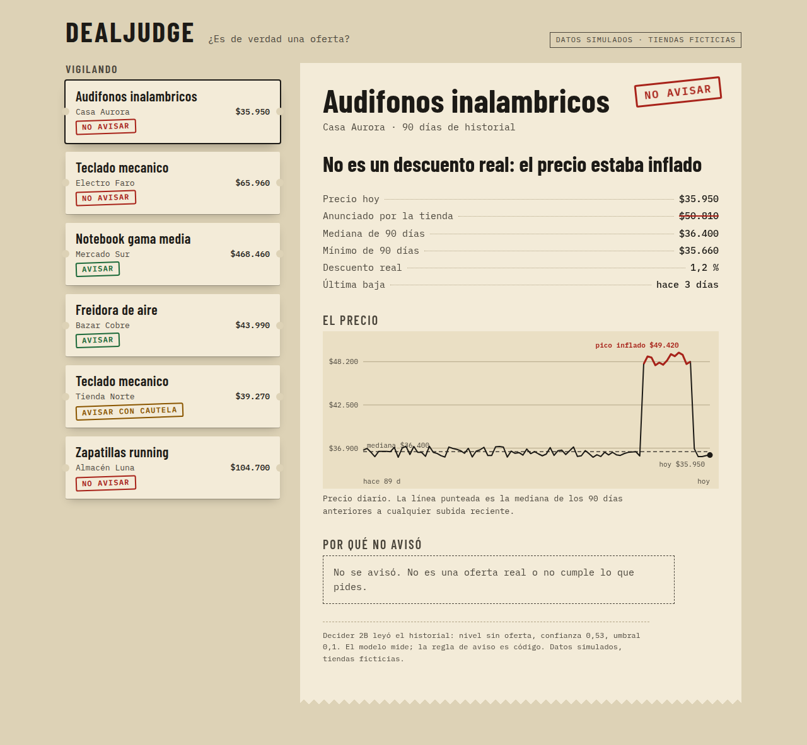
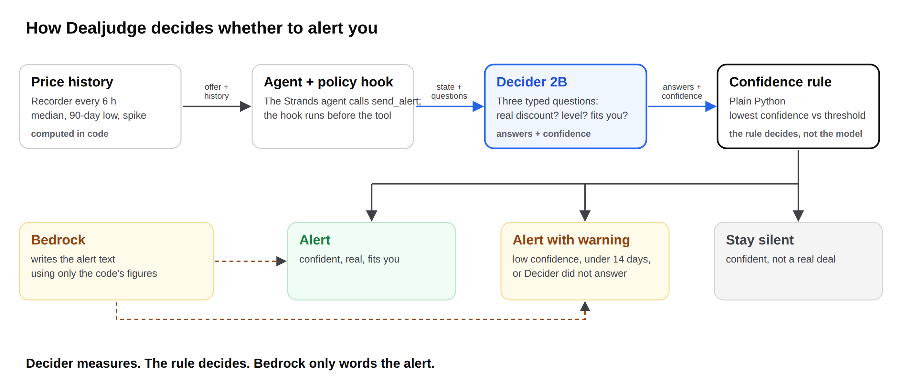

# Dealjudge

**Is this discount real?** Dealjudge watches specific products and judges each discount against the
last 90 days of prices. It speaks up only when there is something real to say, or when it has doubts,
and then it says so.

*Spanish version: [README.es.md](README.es.md).*



*Everything in the screenshot is simulated; the stores are invented.*

Built for the AWS **Agent Experience Hackathon: Strands Decider**. Pattern tag: `#policy`.

## What it does

During Cyber sales, stores often raise a price for a few weeks and then "discount" it back to where it
always was. For every offer, Dealjudge asks [Strands Decider 2B](https://huggingface.co/StrandsAgents/strands-decider-2B-hobson-v19)
to read a short, structured summary of the price history (all arithmetic is done in code) and answer typed questions:

| Question | Type | Who answers |
|---|---|---|
| Is the real discount 10 % or more, against the median of the 90 days before any recent spike? | yes/no | Decider |
| What level of offer is it? `no_deal` / `marginal` / `good` / `very_good` / `exceptional` | choice | Decider |
| Does it fit this user (price cap, minimum level)? | yes/no | **code** (see Limits) |

A plain-Python rule (`src/dealjudge/policy.py`) turns the answers into one of three actions:

- **`alert`**: a real discount that fits the user is announced, with the figures behind it.
- **`stay_silent`**: a confident "not real" or "does not fit" stays silent.
- **`alert_with_warning`**: any doubt (low confidence, or under 14 days of history) is announced **with a visible warning**.

A Strands `InterventionHandler` applies that decision before the `send_alert` tool runs
(`src/dealjudge/handler.py`), and Amazon Bedrock writes the alert text using only the figures the code hands it.
The model is never the gate: Decider measures, `decide` decides.



**One language per run.** Everything the model reads and the user sees (state text, questions, notices, reasons)
comes from `src/dealjudge/i18n.py`, in English (default) or Spanish (`--lang es`). Internal identifiers are always English.

## Run it

```bash
uv venv && uv pip install -e ".[dev]"            # Python >= 3.10
.venv/bin/pytest -q                              # unit tests, no network

# 1. Decider (needs a GPU: about 300 ms per call on a laptop GPU, about 12 s on CPU)
strands-decider serve StrandsAgents/strands-decider-2B-hobson-v19 --port 8000
.venv/bin/python scripts/smoke_decider.py --lang en    # prints the raw answers

# 2. Evaluation: Decider vs the old rule vs an LLM, on simulated offers
export AWS_PROFILE=<profile with Bedrock access>  # needs awscrt for `aws login` profiles
.venv/bin/python scripts/run_evaluation.py --n 30 --lang en    # writes results/en/

# 3. The agent end to end, and the page
.venv/bin/python scripts/run_agent_demo.py --lang en
.venv/bin/python scripts/build_demo.py --lang en               # writes web/data/demo.en.json
python -m http.server -d web 8765                              # then open http://localhost:8765
```

Bedrock models used: `us.anthropic.claude-haiku-4-5-20251001-v1:0` (LLM baseline) and `amazon.nova-lite-v1:0`
(alert text and the agent's own model), both in `us-east-1`.

## Evaluation

`results/<lang>/evaluation.md` is generated by `scripts/run_evaluation.py` and holds the numbers for the article:
alert-vs-silence accuracy, real/fake and level accuracy, accuracy by scenario, latency, cost and calibration.
The confidence threshold (0.1) is fixed on a development split (seed 101) and the numbers are reported on a separate
test split (seed 303, never inspected while tuning). 210 simulated test offers, run once per language.

| Metric (test split) | Decider + rule, EN | Decider + rule, ES | Old `cyber-watch` rule | Claude Haiku 4.5, EN / ES |
|---|---|---|---|---|
| Alert vs silence accuracy | **0.943** | 0.919 | 0.814 | 0.938 / 0.938 |
| 3-way action accuracy | 0.943 | 0.895 | 0.690 | 0.933 / 0.929 |
| Real vs fake accuracy | 1.000 | 0.948 | n/a | 0.962 / 0.971 |
| Offer level accuracy | 0.790 | 0.743 | n/a | 0.919 / 0.948 |
| Failed calls | 0 | 0 | 0 | 8 / 6 |

Decider + rule is clearly better than the old rule (+13 points in English, +10 in Spanish). Against the larger LLM
it is a **technical tie on whether to alert** (0.943 vs 0.938 in English is noise at n=210) and it **loses on the
offer level** (0.79 vs 0.92). What it adds is one local call with no API cost, no failed calls (the LLM failed 8 and
6 times, counted as warnings) and probabilities the code uses to warn instead of guess: it answered decisively on
86 % (EN) / 83 % (ES) of offers and was right 93 % / 91 % of the time on those.

**Latency and cost, measured on their own** (`scripts/bench_latency_cost.py`, English, 70 simulated states from the
development seed, sequential calls, Decider and the LLM in separate phases; results in `results/bench/en/`):

| | Decider 2B (laptop RTX 4050, local) | Claude Haiku 4.5 (Bedrock, from the same machine) |
|---|---|---|
| Median latency | **278 ms** (p95 336 ms) | 940 ms (574 ms as reported by Bedrock) |
| Failed calls | 0 of 70 | 52 of 70 (rate limited, retries off) |
| API cost per 1,000 decisions | 0 | US$0.53 (383 tokens in, 29 out each) |

These are not the same setup: a local GPU next to the script against a remote API reached over the internet from
Chile, so the gap is part model, part network. The LLM's p95 is not reliable (18 successful calls). This account's
Bedrock quota rate-limited most sequential calls, which is probably why the LLM failed 8 and 6 times in the
evaluation. The evaluation's own latency lines (484 ms EN, 744 ms ES for Decider) interleave Decider and LLM calls;
in my tests that inflated Decider (545 ms interleaved against 278 ms in separate phases), probably because the laptop
GPU lowers its clock while it waits for the slow LLM calls. Quote the benchmark, not those lines. Only English was
benchmarked.

**English reads better.** On the same offers Decider scored higher in English than in Spanish (real/fake 1.00 vs
0.95, level 0.79 vs 0.74, alert 0.943 vs 0.919). The same direction appeared on the development seed. The LLM baseline
did not show it.

**All offers in the evaluation are simulated.** `src/dealjudge/generator.py` builds 90-day price series from seven
scenarios (inflated spike, genuine drop, normal fluctuation, recurring sale, short history, and cases on the 10 % and
25 % edges), and the correct answer comes from `truth_for()` over the series' own figures. Because the truth is
rule-derived, the benchmark measures how well a 2B model *reads* the figures; it is not evidence about real
stores. The old `cyber-watch` rule (alert on a 20 % drop from the last price) is an independent baseline. The
generator is public so anyone can check what "real" means here.

## The reusable pattern

`patterns/policy/policy_gate.py` is a single file: a typed question gates a tool call, and your own Python function
decides. See [`patterns/policy/README.md`](patterns/policy/README.md) ([español](patterns/policy/README.es.md)) for the wiring and what we learned.

## Price registrar

`snapshot.py` records prices of eight generic products from three Chilean retail sites into SQLite every six
hours (`DB_PATH`, optional token-protected download endpoints). It is what will give Dealjudge real history over
time. Scraping retail sites sits in a grey zone: check each store's terms before running it yourself.

## Limits (read these)

- **Decider cannot do arithmetic.** It answered "does it fit this user?" (a price against a cap *and* a level
  against a minimum) correctly less often than chance (44 % English, 41 % Spanish on the test split), so that
  comparison runs in code. The model's own answer is still recorded and reported.
- **Its `confidence` is not a probability.** For the offer level it lives on a low scale; the threshold is
  calibrated on data (`calibrate_threshold`) instead of fixed at 0.70. With the default 0.70, nearly everything warns.
  Calibration error is moderate for real/fake (ECE 0.13 EN / 0.17 ES, mostly under-confidence: the model is right
  more often than it says) and poor for the level (0.37 / 0.35).
- **It is weakest in the middle.** Level accuracy for `very_good` is 0.52 (EN) / 0.46 (ES), and offers right at
  the 10 % line are no better than the old rule (0.60 EN / 0.67 ES; the LLM scores 0.83).
- **Phrasing matters a lot.** Asking "is this discount real?" got 53 %; pointing the model at the line that
  holds the figure got 94 % (development split).
- Short histories (under 14 days) always warn, by rule, before the model is consulted.
- Real recorded prices have no ground truth. Knasta's own state is kept in the database as a reference only.
- Alert delivery by email, adding products by message with a photo, and Decider on SageMaker are not built yet.

## License

Apache-2.0. Both the Decider checkpoint and its base model, Qwen3.5-2B-Base, are Apache-2.0 according to their
model cards. Bundled fonts are under the SIL Open Font License (see `NOTICE`).
